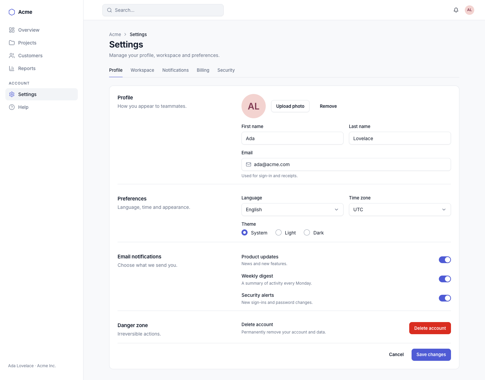
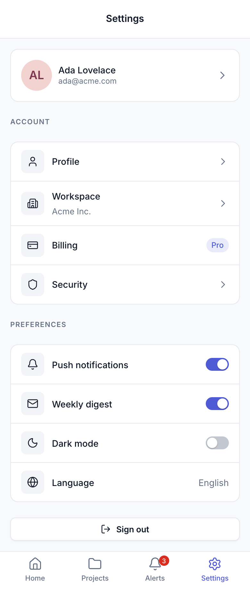
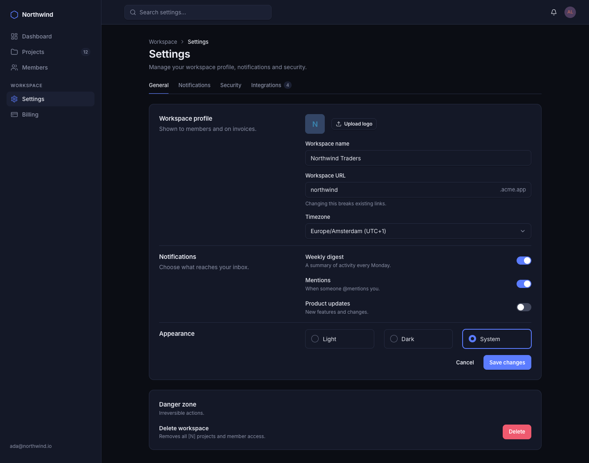
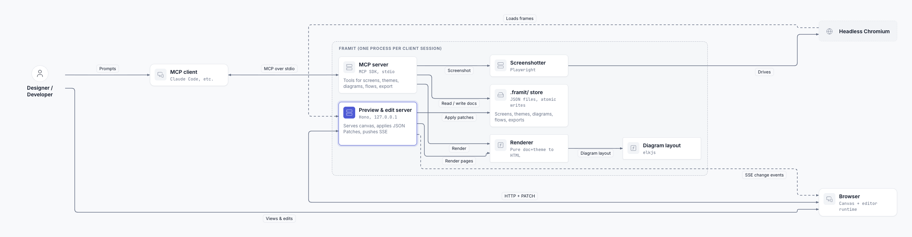

# Examples

## M1 acceptance: blind session

A fresh Claude Code session (Sonnet) with no access to this repo, only the Framit MCP tools, was given:

> wireframe a settings page for a SaaS app, desktop and phone

It called `get_project`, `describe_dsl`, `list_themes`, `init_project`, `get_theme` and one `write_screen`
(no validation errors, no retries). Eight turns.

| Desktop | Phone |
|---|---|
|  |  |

The stored document is [m1-settings.json](m1-settings.json).

## Same structure, dark starter theme

A hand-written settings screen rendered in `wire-mid-dark`:

## M4 acceptance: blind diagram session

A fresh Claude Code session (Sonnet) ran in a copy of this repo with the Framit MCP tools and was given:

> Draw the system context for this repo.

It read `docs/02-architecture.md`, called `describe_dsl` (kind `diagram`) and wrote one diagram: 10 nodes,
13 edges, one group, with no validation errors or retries. That took eight turns and cost $0.14.

The stored document is [m4-system-context.json](m4-system-context.json). The screenshot above is the
document re-rendered after the fixes listed below.

The session's own critique ("descriptions clipped, long return edges wrap the drawing") led to three fixes:

- **Node sizes:** the size estimate now wraps `tech` lines and uses more generous glyph widths, so no
  node clips its text.
- **Cycle breaking:** cycles are broken in favour of the authors' listing order (elk `GREEDY_MODEL_ORDER`).
  The authoring guide asks for nodes in reading order, actors and clients first.
- **Lint warning:** a new warning flags `a → b` plus `b → a`. In this run that is the browser pair, where
  `bidirectional` plus an SSE edge belong on one edge.

Half-pixel rounding in elk routes also showed up as a diagonal kink, so the router now snaps those
coordinates.
